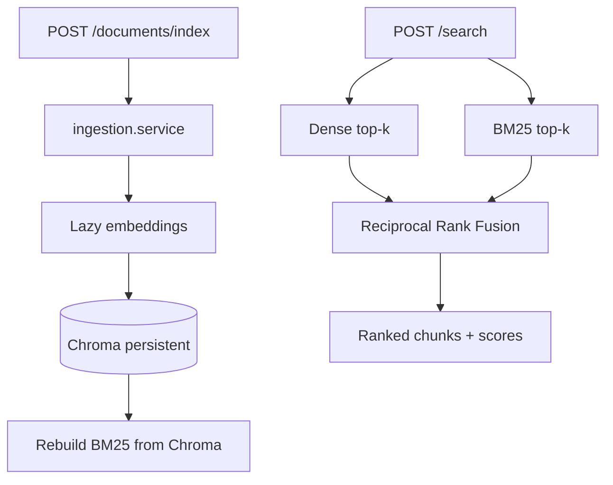

# Engineering Knowledge Intelligence Platform

A modular retrieval-augmented generation (RAG) platform for engineering documentation.

| Phase | Scope |
| --- | --- |
| **1** | FastAPI scaffold, config, health checks |
| **2** | Upload, parse (PDF / Markdown / HTML), chunking |
| **3** | Chroma + BM25 indexing, hybrid search (RRF) |
| **4** | Reranking, grounded answers (Gemini default / optional Ollama), Streamlit UI |
| **5** | Evaluation harness, security hardening, deployment artifacts |

The core workflow uses local retrieval; **answer generation defaults to Google Gemini** (requires an API key and internet). Ollama remains optional for fully offline LLM inference.

## Tech stack

| Layer | Technology |
| --- | --- |
| Runtime | Python 3.12+ |
| API | FastAPI, Uvicorn |
| Vector store | Chroma (persistent, local) |
| Keyword retrieval | BM25 (`rank-bm25`) |
| Embeddings | `sentence-transformers/all-MiniLM-L6-v2` (lazy-loaded) |
| Reranking | `cross-encoder/ms-marco-MiniLM-L-6-v2` (lazy, optional) |
| Answer generation | **Google Gemini** (default, OpenAI-compatible API), optional Ollama, mock for tests |
| UI | Streamlit (`app/ui.py`) |
| PDF parsing | PyMuPDF |
| Markdown / HTML | `markdown`, Beautiful Soup |
| Config | `pydantic-settings` |
| Tests | pytest (mock embeddings, temp index dirs) |

## Architecture

```
engineering-knowledge-platform/
├── app/
│   ├── main.py
│   ├── api/
│   │   ├── routes.py          # GET /, GET /health
│   │   ├── documents.py       # upload, index, list, delete
│   │   ├── search.py          # POST /search
│   │   └── answer.py          # POST /answer
│   ├── generation/
│   │   ├── answer.py          # retrieve → rerank → generate
│   │   └── providers.py       # Ollama / hosted / mock LLM
│   ├── ui.py                  # Streamlit chat UI
│   ├── ui_client.py           # HTTP client used by Streamlit
│   ├── core/config.py
│   ├── ingestion/             # parse + chunk (Phase 2)
│   └── retrieval/
│       ├── chroma_store.py    # canonical vector index
│       ├── bm25_store.py      # BM25 rebuilt from Chroma records
│       ├── embeddings.py      # lazy SentenceTransformer + test mock
│       ├── reranker.py        # optional cross-encoder rerank
│       ├── indexer.py         # index / delete orchestration
│       ├── search.py          # dense, BM25, hybrid (RRF)
│       └── fusion.py
├── data/processed/            # chroma + bm25 snapshot (dev)
└── tests/
```

### Indexing and hybrid retrieval (Phase 3)



**Canonical store:** Chroma holds chunk text, embeddings, and metadata (`document_id`, `filename`, `file_type`, `chunk_index`, `page_number`).

**BM25 sync:** After every successful index or delete, BM25 is rebuilt from all Chroma records. A JSON snapshot (`BM25_INDEX_PATH`) speeds restarts but is always reconciled against Chroma when the index service starts.

**Consistency / recovery:**

1. Indexing deletes existing vectors for the target `document_id`, writes new vectors to Chroma, then rebuilds BM25.
2. If BM25 rebuild fails after a Chroma write, vectors for that `document_id` are rolled back and the API returns `500`.
3. If delete succeeds in Chroma but BM25 rebuild fails, the API returns `500` (Chroma already reflects the deletion; retry the request or restart the service to rebuild BM25 from Chroma).
4. To reset a dev index: stop the API, delete `data/processed/chroma` and `data/processed/bm25_index.json`, then restart.

**Document identity:** Re-uploading the same filename produces the same `document_id` (UUID v5 of the normalized filename), so indexed content is replaced instead of duplicated.

**Embeddings:** The SentenceTransformer model loads on first index/search that needs vectors—not at import time—so `/` and `/health` work without downloading weights.

### First-run model download

The first call to `POST /documents/index` or dense/hybrid search downloads `sentence-transformers/all-MiniLM-L6-v2` from Hugging Face into the local cache (typically `~/.cache/huggingface/`). Expect roughly **~90 MB** disk usage for the model plus Chroma data under `CHROMA_PATH`.

## Setup

```bash
python -m venv .venv
source .venv/bin/activate
pip install -r requirements.txt
cp .env.example .env
```

| Variable | Description | Default |
| --- | --- | --- |
| `CHROMA_PATH` | Persistent Chroma directory | `data/processed/chroma` |
| `CHROMA_COLLECTION_NAME` | Collection name | `engineering_knowledge` |
| `BM25_INDEX_PATH` | BM25 JSON snapshot | `data/processed/bm25_index.json` |
| `EMBEDDING_MODEL` | SentenceTransformer model id | `all-MiniLM-L6-v2` |
| `RETRIEVAL_TOP_K` | Default search top-k | `5` |
| `RRF_K` | RRF constant | `60` |
| `RERANK_ENABLED` | Enable cross-encoder reranking | `true` |
| `RERANK_MODEL` | Cross-encoder model id | `cross-encoder/ms-marco-MiniLM-L-6-v2` |
| `RERANK_CANDIDATE_K` / `RERANK_TOP_K` | Candidate pool / final evidence count | `20` / `5` |
| `MAX_EVIDENCE_CHUNKS` / `MAX_CONTEXT_CHARS` | LLM context limits | `5` / `8000` |
| `LLM_PROVIDER` | `gemini`, `ollama`, `openai_compatible`, or `mock` | `gemini` |
| `GEMINI_API_KEY` | Google AI Studio API key (server-side only) | *(required for gemini)* |
| `GEMINI_BASE_URL` | Gemini OpenAI-compatible base URL | `https://generativelanguage.googleapis.com/v1beta/openai` |
| `GEMINI_MODEL` | Gemini model id (Flash recommended) | `gemini-3.5-flash-lite` |
| `OLLAMA_BASE_URL` / `OLLAMA_MODEL` | Optional local Ollama | `http://127.0.0.1:11434` / `llama3.2` |
| `OPENAI_COMPATIBLE_*` | Optional hosted OpenAI-compatible API | unset key by default |
| `LLM_TIMEOUT_SECONDS` | HTTP read timeout while waiting for model output | `120` |
| `LLM_CONNECT_TIMEOUT_SECONDS` / `LLM_WRITE_TIMEOUT_SECONDS` / `LLM_POOL_TIMEOUT_SECONDS` | Other HTTP timeouts (seconds) | `10` / `30` / `10` |
| `LLM_MAX_RETRIES` / `LLM_RETRY_BACKOFF_SECONDS` | Bounded retries for transient 429/503 (etc.) | `2` / `1` |
| `LLM_MAX_OUTPUT_TOKENS` | Cap on Gemini/OpenAI-compat completion tokens | `768` |
| `MAX_CONTEXT_CHARS` | Max retrieved evidence characters in LLM prompts | `8000` |
| `BACKEND_URL` | Streamlit → FastAPI base URL | `http://127.0.0.1:8000` |
| `MAX_UPLOAD_SIZE_BYTES` | Upload limit | `10485760` |
| `CHUNK_SIZE` / `CHUNK_OVERLAP` | Chunking | `512` / `64` |

### LLM provider (Gemini default)

1. **Google Gemini (default):** create an API key in [Google AI Studio](https://aistudio.google.com/apikey). Copy `.env.example` to `.env` and set:
   - `LLM_PROVIDER=gemini`
   - `GEMINI_API_KEY=your_key_here` (never commit the real key)
   - `GEMINI_MODEL=gemini-3.5-flash-lite` (default; see [Gemini models](https://ai.google.dev/gemini-api/docs/models)). Higher free-tier RPD than Gemini 3.8 Flash.
2. **Embedding / rerank models:** downloaded lazily on first index/search/answer that needs them (`~90 MB` embedder, cross-encoder additional download when reranking is enabled).
3. **Optional Ollama (offline):** set `LLM_PROVIDER=ollama`, install [Ollama](https://ollama.com), and pull your model.
4. **Optional OpenAI-compatible API:** set `LLM_PROVIDER=openai_compatible` and configure base URL/model/API key.

Gemini requires **internet access** and may incur **usage limits or charges**. The Streamlit UI talks only to FastAPI; the browser never sees your API key.

**Troubleshooting**

| Issue | What to check |
| --- | --- |
| Missing key | `GET /health/llm` or sidebar LLM status; set `GEMINI_API_KEY` in `.env` and restart the backend |
| Quota / 429 | Check AI Studio → Rate limit: **RPD** (daily) vs **RPM** / **TPM**. Default `gemini-3.5-flash-lite` has higher free RPD than `gemini-3.8-flash`. Daily exhaustion is not fixed by retries—change model, wait for reset, or enable billing |
| Timeouts | Increase `LLM_TIMEOUT_SECONDS`; try `gemini-3.5-flash-lite`; check network |
| Model not found | Update `GEMINI_MODEL` to a supported id from the official models page |
| Stream chat 502 | Backend could not complete chat before streaming; check LLM health and model id (fixed: errors return JSON before SSE headers) |
| Wrong provider | Ensure `LLM_PROVIDER=gemini` and restart uvicorn after `.env` changes |

## Run the stack

**API:**

```bash
uvicorn app.main:app --reload --host 127.0.0.1 --port 8000
```

**Streamlit UI (recommended — from repository root):**

```bash
export BACKEND_URL=http://127.0.0.1:8000
python -m streamlit run streamlit_app.py
```

**One-command local launch (macOS):**

```bash
./start.sh
```

You can still run `streamlit run app/ui.py` from the repo root; `app/ui.py` now adds the project root to `PYTHONPATH` automatically.

## API examples

**Health (no model download):**

```bash
curl http://127.0.0.1:8000/health
```

**Parse only (Phase 2, no indexing):**

```bash
curl -X POST http://127.0.0.1:8000/documents/upload -F "file=@manual.pdf"
```

**Parse + index:**

```bash
curl -X POST http://127.0.0.1:8000/documents/index -F "file=@manual.pdf"
```

**List indexed documents:**

```bash
curl http://127.0.0.1:8000/documents
```

**Hybrid search (default):**

```bash
curl -X POST http://127.0.0.1:8000/search \
  -H "Content-Type: application/json" \
  -d '{"query":"pressure vessel design", "strategy":"hybrid", "top_k": 5}'
```

**BM25-only or dense-only:**

```json
{"query": " flange bolt torque ", "strategy": "bm25"}
{"query": " flange bolt torque ", "strategy": "dense"}
```

**Metadata filters:**

```json
{
  "query": "safety factor",
  "file_type": "pdf",
  "document_id": "<uuid-from-index-response>"
}
```

**Grounded answer (retrieve → rerank → generate):**

```bash
curl -X POST http://127.0.0.1:8000/answer \
  -H "Content-Type: application/json" \
  -d '{
    "question": "What does the manual say about Alpha content?",
    "strategy": "hybrid",
    "candidate_k": 20,
    "top_k": 5,
    "rerank": true
  }'
```

Response includes `answer`, validated `citations` (chunk id, filename, page, excerpt), `evidence`, and retrieval metadata. If indexed evidence is insufficient, `sufficient_evidence` is `false` and the API returns an explicit uncertainty message without inventing citations.

```bash
curl -X DELETE http://127.0.0.1:8000/documents/<document_id>
```

**Deployment health check:**

```bash
curl http://127.0.0.1:8000/health/deployment
```

## Evaluation (Phase 5)

Reproducible fixture dataset and metrics live under `app/evaluation/` and `docs/EVALUATION.md`.

```bash
python scripts/run_evaluation.py
pytest tests/test_evaluation.py -v
```

**Measured mock results (k=5, not live models):** on the fixture dataset, BM25 and hybrid+rerank both achieved Recall@5 **1.0** and MRR **1.0**; dense MRR **0.667**; unanswerable questions returned `sufficient_evidence: false`. See `docs/EVALUATION.md` for full tables and methodology.

## Security and isolation (Phase 5)

| Control | Status |
| --- | --- |
| Upload filename sanitization / `..` rejection | Implemented (`app/core/security.py`) |
| Extension + Content-Type checks | Implemented (best-effort) |
| UUID validation on delete | Implemented |
| Untrusted chunk delimiters in LLM prompts | Implemented + tested |
| Citation IDs restricted to retrieved evidence | Implemented |
| Insufficient-evidence answers | Implemented (stopword-aware overlap heuristic) |
| Generic 500 responses in non-development envs | Implemented |
| Authentication / multi-tenant isolation | **Not implemented** |

## Ephemeral multi-visitor sessions

Enable isolated **temporary** RAG per browser session (no shared persistent index). **Default: on** (`EPHEMERAL_SESSIONS_ENABLED=true`).

To use a single shared demo index instead (solo local dev only):

```bash
EPHEMERAL_SESSIONS_ENABLED=false
```

For explicit multi-visitor config:

```bash
EPHEMERAL_SESSIONS_ENABLED=true
SESSION_STORE_ROOT=data/ephemeral_sessions
SESSION_TTL_SECONDS=3600
SESSION_CLEANUP_INTERVAL_SECONDS=300
```

**Flow**

1. Streamlit calls `POST /session` and receives a UUID v4 `session_id`.
2. Every API call sends header `X-Session-ID: <session_id>`.
3. Each session gets its own temp Chroma + BM25 under `SESSION_STORE_ROOT/<session_id>/`.
4. Chat history for follow-ups is stored **server-side** per session (client history is not trusted when ephemeral mode is on).
5. `POST /session/reset` clears that session’s documents and chat; `DELETE /session` removes the session.
6. Idle sessions are deleted after `SESSION_TTL_SECONDS`; all session dirs are removed on API shutdown.

**Limits**

- Session registry is **in-process memory** — not shared across multiple uvicorn workers. For multi-visitor demos use **one worker** (`uvicorn app.main:app --workers 1`) or accept that sessions stick to the worker that created them.
- After **API restart**, all session indexes and histories are gone (by design).
- Gemini remains server-side only; sessions do not share API keys.

When `EPHEMERAL_SESSIONS_ENABLED=false`, the app uses the legacy shared `CHROMA_PATH` / `BM25_INDEX_PATH` (single-user demo mode).

**Single-user mode (`SINGLE_USER_MODE=true`):** legacy flag for shared-index deployments; use ephemeral sessions for concurrent visitors.

## Deployment

**Production checklist**

| Item | Recommendation |
| --- | --- |
| `ENVIRONMENT=production` | Enables generic 500 responses and startup validation |
| `EPHEMERAL_SESSIONS_ENABLED=true` | Default; isolated per-visitor indexes |
| `uvicorn ... --workers 1` | Required while session registry is in-process |
| `GEMINI_API_KEY` | Server-side only; set via host env / secrets manager |
| `BACKEND_URL` | Streamlit (or other UI) must reach the API **service URL** (e.g. `http://api:8000` in Compose, not user browser localhost) |
| `CORS_ALLOW_ORIGINS` | Only if a browser SPA calls the API directly |
| Authentication | **Not included** — public exposure requires your own auth / network controls |

**Docker (API, mock LLM default, ephemeral sessions):**

```bash
docker build -t ekip-api .
docker run --rm -p 8000:8000 \
  -e LLM_PROVIDER=mock \
  -e EPHEMERAL_SESSIONS_ENABLED=true \
  -v ekip-sessions:/data/ephemeral_sessions \
  ekip-api
curl http://127.0.0.1:8000/health
```

**Docker Compose (API + Streamlit):**

```bash
docker compose up --build
# API: http://127.0.0.1:8000  UI: http://127.0.0.1:8501
# UI container uses BACKEND_URL=http://api:8000 (internal DNS).
```

For Gemini in production, add a local `.env` (gitignored) with `LLM_PROVIDER=gemini` and `GEMINI_API_KEY`, then `docker compose up`. Compose loads `.env` when present; never commit keys.

**Legacy shared index (solo dev only):** set `EPHEMERAL_SESSIONS_ENABLED=false` and mount `/data` for `CHROMA_PATH` / `BM25_INDEX_PATH`.

**Free-tier hosting notes (realistic):**

| Component | Typical free tier fit |
| --- | --- |
| FastAPI + Chroma + BM25 | Possible with ≥1–2 GiB RAM and persistent volume |
| SentenceTransformer + cross-encoder downloads | Heavy on disk (~100MB+) and RAM; expect cold-start delays |
| Ollama inside container | **Usually not feasible** on small free tiers (RAM/CPU) |
| Recommended alternative on free hosts | `LLM_PROVIDER=openai_compatible` or external inference; disable rerank/embeddings unless resources allow |

Public deployment, TLS, and secrets management were **not verified** in this phase—treat instructions as preparation only.

## Tests

```bash
pytest tests/ -v
```

**Mock suite (default):** run without `GEMINI_API_KEY` — all integration tests use `MockLLMProvider` and temp index directories.

**Optional live Gemini check:**

```bash
export GEMINI_API_KEY=your_key   # never commit
export GEMINI_MODEL=gemini-3.5-flash-lite   # optional; faster smoke test
pytest tests/test_gemini_live.py -v
```

**Requires manual verification:** cross-encoder downloads on first rerank, public cloud deployment, Streamlit browser UX with real Gemini latency.

## Remaining risks

- **No authentication** — ephemeral sessions isolate indexes but do not identify users; anyone with the URL can create sessions and upload content within quota limits.
- Prompt-injection mitigations are prompt-level, not foolproof
- Evidence sufficiency heuristic can false-negative/positive on edge queries
- BM25 rebuilt in memory on each index/delete at scale
- Filename-based document replacement (not content hash)

## Development principles

- Typed, modular Python; no fake RAG or fabricated citations
- Chroma is canonical; BM25 is derived and rebuilt after mutations
- Evidence chunks are untrusted data; prompts instruct the LLM not to follow instructions embedded in documents
- Report measured evaluation results separately from live-model expectations
